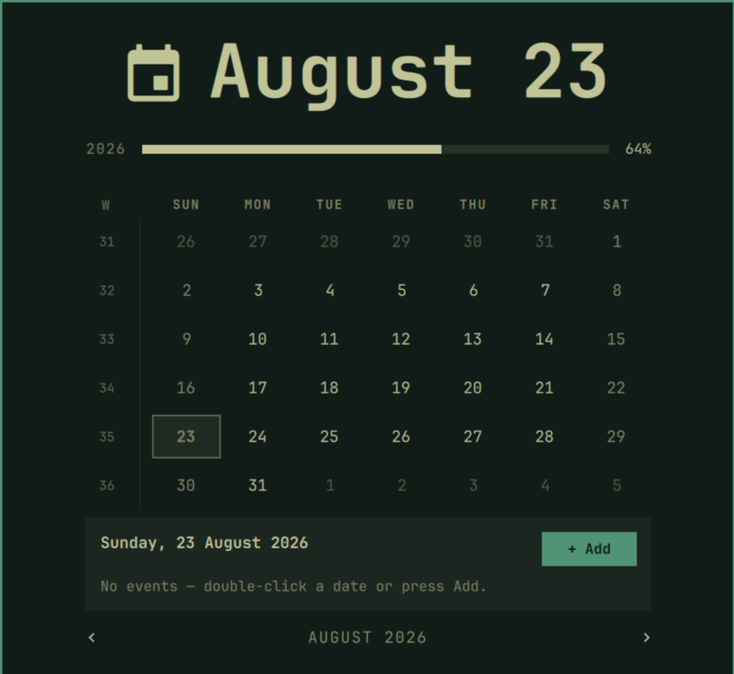

# Calendar Plus for Omarchy

An enhanced Omarchy clock and calendar widget with a useful popup agenda and time-progress views.



## Features

- Configurable horizontal and vertical clock formats
- Right-click format cycling and middle-click timezone selection
- Six-row monthly calendar with ISO week numbers
- Monday/Sunday week-start toggle
- Local agenda with add, edit, and delete actions
- Year-progress indicator
- Optional private life-progress reminder
- Keyboard, wheel, and button month navigation

Calendar events remain local in `~/.local/state/omarchy/calendar/events.json` and are never included in the plugin repository.

## Install

```bash
omarchy plugin add https://github.com/elixirblend/omarchy-calendar-plus --enable
omarchy plugin enable sofos.clock center
```

## License

MIT
